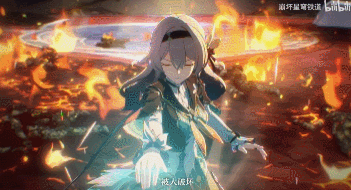
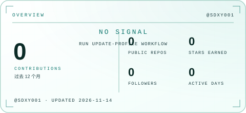
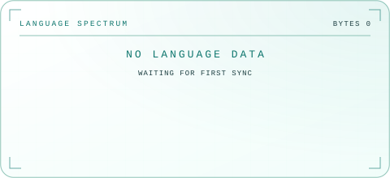
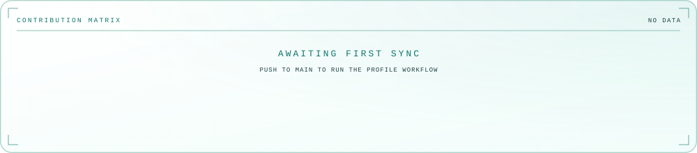
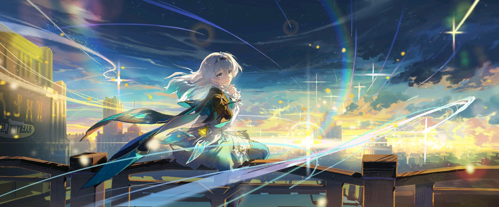

<picture>
  <source media="(prefers-color-scheme: dark)" srcset="assets/Firefly_henshin.gif">
  
</picture>

 

 

 

## ◈ 关于我

<table>
  <tr>
    <td width="100%" valign="top">
      <h3>你好，我是 霜冻咸鱼</h3>
      
一名普通学生，目前 <strong>正在摸鱼</strong>。

      
「我们终将在那里，找到答案」

    </td>
  </tr>
</table>

## ◈ 技术栈

 

<!-- SECTION:stats:start -->
## ◈ 星图 · GitHub

<picture>
  <source media="(prefers-color-scheme: dark)" srcset="assets/generated/overview-dark.svg">
  
</picture>
&nbsp;
<picture>
  <source media="(prefers-color-scheme: dark)" srcset="assets/generated/languages-dark.svg">
  
</picture>

  

<picture>
  <source media="(prefers-color-scheme: dark)" srcset="assets/generated/activity-dark.svg">
  
</picture>

 

<!-- SECTION:stats:end -->

<!-- SECTION:snake:start -->
## ◈ 星轨 · 贡献

<picture>
  <source media="(prefers-color-scheme: dark)" srcset="https://raw.githubusercontent.com/SDXY001/SDXY001/output/github-contribution-grid-snake-dark.svg">
  
</picture>

「愿我们在清醒的现实再会」

<!-- SECTION:snake:end -->

<!-- SECTION:projects:start -->
## ◈ 航迹 · 精选项目

| 项目 | 技术 | 简介 |
| :--- | :--- | :--- |
| **[persona_Firefly-Honkai-star-rail_Chinese-Version-](https://github.com/SDXY001/persona_Firefly-Honkai-star-rail_Chinese-Version-)** |  | 让你的AstrBot化身星间的萤火虫 |
<!-- SECTION:projects:end -->

<!-- SECTION:quote:start -->
 

<picture>
  <source media="(prefers-color-scheme: dark)" srcset="assets/Firefly_background.jpg">
  
</picture>
<!-- SECTION:quote:end -->

## ◈ 连接

 

 

<picture>
  <source media="(prefers-color-scheme: dark)" srcset="assets/Firefly_henshin.gif">
  
</picture>

 

 

漫步繁星

